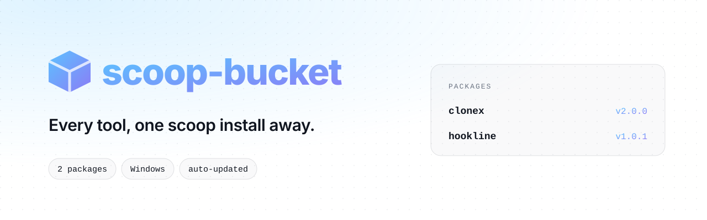
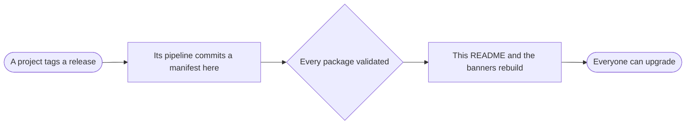

<!-- Generated by scripts/update_readme.py after every package change. Edit that script, not this file. -->
<div align="center">

<picture>
  <source media="(prefers-color-scheme: dark)" srcset="assets/banner-dark.svg">
  
</picture>

<br>

**Every command-line tool from Vante, installed and updated with [Scoop](https://scoop.sh).**

<br>

[](https://scoop.sh)
[](#packages)
[](#packages)
[](#how-it-works)

**[Packages](#packages)** ·
**[Install](#install)** ·
**[Upgrade](#upgrade-and-uninstall)** ·
**[How it works](#how-it-works)** ·
**[Add a package](#add-a-package)**

</div>

<br>

## Packages

| Package | Version | Runs on | What it does | Install |
| --- | --- | --- | --- | --- |
| [**clonex**](https://github.com/kaanxsrd/CloneX) | `2.0.0` | Windows (x64, arm64) | Preview and copy the structure of a Discord server. | `scoop install clonex` |
| [**hookline**](https://github.com/kaanxsrd/hookline) | `1.0.1` | Windows (x64, arm64) | Catch every webhook. Replay anything. Pipe it to localhost. | `scoop install hookline` |

## Install

```powershell
scoop bucket add kaanxsrd https://github.com/kaanxsrd/scoop-bucket
scoop install <package>
```

You only need to add the bucket once.

## Upgrade and uninstall

```powershell
scoop update; scoop update <package>
scoop uninstall <package>
scoop bucket rm kaanxsrd   # optional: remove this bucket
```

## How it works



Each project's release pipeline publishes its own builds and commits the result here, with the download URLs and SHA-256 checksums of that release. GitHub Actions then checks every package and rebuilds this page, so the list above is always what the repository really contains.

## Add a package

Have the project's release pipeline commit one file: `<package>.json` in the root of this repository. It needs a `version`, `description`, `homepage`, `license`, and a `url` with a SHA-256 `hash`, either directly or for each entry under `architecture`.

That is the only step. The package appears above after the next push, with its version and platforms read from that file. A malformed package fails the [workflow](.github/workflows/update-readme.yml) and leaves this page unchanged.

<details>
<summary><b>Publishing from a release pipeline</b></summary>

<br>

The pipeline needs a token with **Contents: read and write** on this repository. To publish under your own account rather than a bot, commit with your GitHub no-reply address:

```sh
git config user.name "$GITHUB_REPOSITORY_OWNER"
git config user.email "${GITHUB_REPOSITORY_OWNER_ID}+${GITHUB_REPOSITORY_OWNER}@users.noreply.github.com"
```

With GoReleaser, set the same identity under `commit_author`.

</details>

<div align="center">
<br>
<sub>Generated automatically. Please don't edit package files by hand: the next release replaces them.</sub>
</div>
